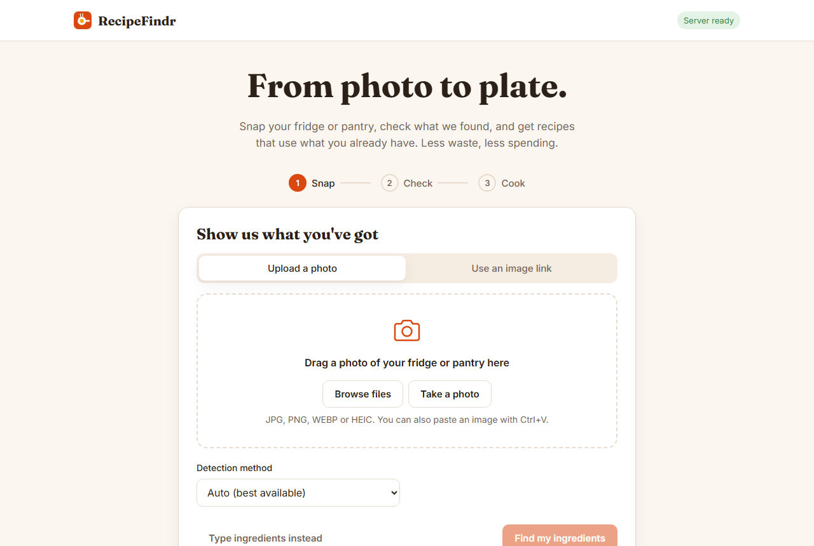

# 🍳 RecipeFindr

**An AI cooking assistant that goes from photo to plate.** Snap a photo of your fridge or pantry, confirm the ingredients RecipeFindr detects, and get real recipes that use what you already have.

Roughly a third of the food in the US is never eaten. RecipeFindr aims to cut household food waste, save money, and make it faster to decide what to cook.

**Live demo:** _add your Vercel URL here_



## Features

- **Photo in, ingredients out.** Upload, drag and drop, paste, or take a photo on your phone. A multimodal LLM (served on Groq) identifies the ingredients and can read packaging labels.
- **Human in the loop.** Review the detected list: remove items with a click, add your own, or edit in plain English ("remove banana, add rice and eggs").
- **Real recipes.** Results come from the Spoonacular API, with the ingredients you have, what you'd still need to buy, cooking time, and step-by-step instructions. No steps are written by the LLM.
- **Preferences.** Vegetarian, vegan, gluten-free and dairy-free filters, a max cooking time, and a choice between "use up what I have" and "fewest extra groceries".
- **Works anywhere.** Responsive layout, light and dark mode, keyboard accessible.

## Tech stack

| Layer | Tools |
| --- | --- |
| Front end | HTML, CSS, vanilla JavaScript (ES modules), no build step |
| Back end | Python, FastAPI |
| AI | Groq (multimodal LLM for vision, LLM for ingredient edits), optional YOLOv8 (Ultralytics) for local object detection |
| Data | Spoonacular recipe API |
| Hosting | Vercel (Python serverless function + CDN for static files) |

## Architecture

```
Browser (public/)                FastAPI (app.py)                      External APIs
───────────────────              ────────────────────────              ─────────────
1. Snap   photo / link   ──►   POST /api/detect           ──►   Groq vision model
                                   services/detection.py              (or local YOLOv8)
2. Check  edit list      ──►   POST /api/ingredients/edit ──►   Groq LLM
                                   services/llm.py
3. Cook   preferences    ──►   POST /api/recipes          ──►   Spoonacular
                                   services/recipes.py
```

### Security and production practices

- **API keys stay on the server.** They are read from environment variables and never sent to the browser. `/api/health` reports only whether each one is configured. The Spoonacular key goes in a request header, not the URL, so it can't leak into logs.
- **SSRF protection.** Image links are resolved and refused if they point to private, loopback or cloud-metadata addresses, and each redirect is re-checked.
- **Rate limiting** per visitor protects the free API quotas on the public demo.
- **Input validation** with Pydantic: size limits on uploads, lists and text.
- **Safe error messages.** Users see friendly messages, and upstream error details go only to the server logs.
- **Safe rendering.** The front end inserts API data with `textContent`, never `innerHTML`.

## How it evolved

RecipeFindr started as a final project for an Agentic AI Foundations course. **v1** was a chat-style agent workflow built with the Agno framework and Agno Playground: a Vision Analyzer agent (YOLOv8), an Ingredient Validator agent, and a Recipe Generator agent, all coordinated through a global-memory state machine.

**v2** (this repo) rebuilds it as a full-stack web app:

| v1 | v2 |
| --- | --- |
| Paste an image path or URL into a chat | Upload, drag and drop, paste or take a photo |
| YOLOv8, which knows about 10 foods | Multimodal LLM, with YOLOv8 as an option |
| Validate by typing commands | Clickable ingredient chips plus plain-English edits |
| LLM-written recipe steps | Real instructions from Spoonacular |
| Global `WORKFLOW_MEMORY` state | Stateless API plus front-end state |
| Runs locally only | Deployed on Vercel |

## Run locally

Requirements: Python 3.10 or newer, a free [Groq API key](https://console.groq.com/keys), and a free [Spoonacular API key](https://spoonacular.com/food-api/console#Profile).

```bash
git clone https://github.com/<your-username>/recipefindr.git
cd recipefindr
python -m venv .venv
.venv\Scripts\activate          # Windows  (macOS/Linux: source .venv/bin/activate)
pip install -r requirements.txt
cp .env.example .env            # then paste your keys into .env
python app.py
```

Open http://localhost:8000. Interactive API docs are at http://localhost:8000/docs.

The optional local YOLOv8 detector is a large download because it installs PyTorch: `pip install -r requirements-yolo.txt`.

## Deploy to Vercel

1. Import this repo at vercel.com via **Add New → Project** and keep the defaults. `app.py` is detected as a FastAPI app, and `public/` is served from the CDN.
2. In **Settings → Environment Variables**, add `GROQ_API_KEY` and `SPOONACULAR_API_KEY`, then redeploy.

YOLOv8 isn't available on Vercel because PyTorch is too large for a serverless function, so the deployed app uses AI vision.

## Project structure

```
├── app.py                 FastAPI app: API routes + local static hosting
├── services/
│   ├── config.py          settings from environment variables
│   ├── detection.py       photo -> ingredients (Groq vision / YOLOv8), safe URL fetching
│   ├── llm.py             Groq client, response parsing, plain-English list edits
│   ├── recipes.py         Spoonacular search, filtering and caching
│   └── ratelimit.py       per-visitor rate limiting
├── public/                front end (index.html, css/, js/, img/)
├── docs/screenshot.png
├── requirements.txt       runtime dependencies
├── requirements-yolo.txt  optional local YOLOv8
└── .env.example           template for local API keys
```

## Team

Built by **Kleef Bellevue**, **Zara Dawodu**, and **Juliana Li**.
